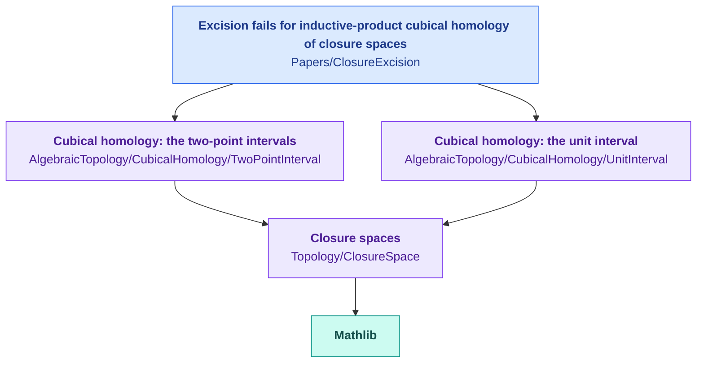

<div align="center">

# Formalizations

Lean 4 formalizations of research papers in mathematics

[](https://github.com/takschdube/formalizations/actions/workflows/ci.yml)
[](https://lean-lang.org)
[](https://github.com/leanprover-community/mathlib4)
[](LICENSE)

</div>

## Goal

This repository collects the Lean 4 formalizations of papers by Taksch Dube and coauthors. The aim is a body of research mathematics in which every result is checked by machine and each new paper builds on the checked work of earlier ones. A paper joins the library on the day it is posted, formalized in full: every theorem, proposition and lemma. Its general definitions and theorems go into the areas of the library, where later papers build on them, so the library extends into each area of mathematics that the papers reach.

## Organization



Arrows are imports. The library has two parts.

- **`Formalizations/`** holds definitions and theorems that do not depend on a particular paper, in folders named as in Mathlib. A paper's general results go here, where later papers import them. Results of general use can move on into Mathlib, which is why this library uses Mathlib's license.
- **`Papers/`** holds one library per paper, with the constructions and examples specific to it and a README that maps the paper's statements to files. A paper cites its release, the tag `<paper>-v1`, which never moves, so later changes on `main` do not change the code a paper cites.

CI builds every library with warnings as errors, so an unfinished proof fails the build, and checks that each statement a paper cites depends only on the axioms `propext`, `Classical.choice` and `Quot.sound`.

## Areas

| Area | Contents |
| :--- | :--- |
| [Closure spaces](Formalizations/Topology/ClosureSpace) | Čech closure spaces, continuity, closure spaces of relations and of topological spaces, the product and the inductive product |
| [Cubical homology](Formalizations/AlgebraicTopology/CubicalHomology) | Singular cubes, chains and normalized relative homology of closure spaces, for the two-point intervals and for the unit interval; excision for small cubes; vanishing of the first homology for the unit interval with the inductive product |

## Papers

| Paper | Release |
| :--- | :--- |
| [Excision fails for inductive-product cubical homology of closure spaces](Papers/ClosureExcision) | `closure-space-excision-v1` |

## Building

```sh
git clone https://github.com/takschdube/formalizations.git
cd formalizations
lake exe cache get    # compiled Mathlib, several GB
lake build
lake env lean scripts/closure-space-excision/check_axioms.lean
```

To build the code a paper cites, check out its release first:

```sh
git checkout closure-space-excision-v1
```

## Citing

```bibtex
@misc{formalizations,
  author       = {Dube, Taksch},
  title        = {Lean 4 formalizations},
  howpublished = {GitHub repository, \url{https://github.com/takschdube/formalizations}},
  year         = {2026}
}
```

## License

Apache License 2.0, the license of Mathlib. See [LICENSE](LICENSE).
