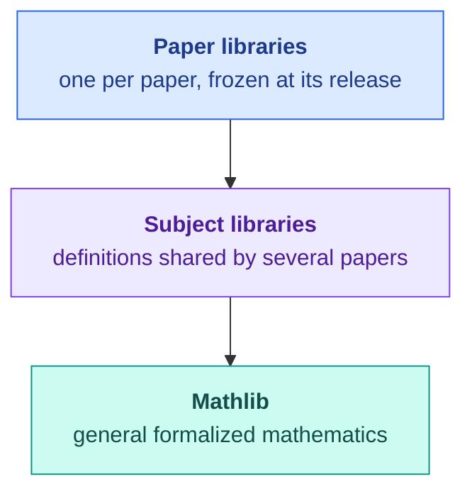

<div align="center">

# Formalizations

Lean 4 formalizations of research papers in mathematics

[](https://github.com/takschdube/formalizations/actions/workflows/ci.yml)
[](https://lean-lang.org)
[](https://github.com/leanprover-community/mathlib4)
[](LICENSE)

</div>

## Goal

This repository collects the Lean 4 formalizations of papers by Taksch Dube and coauthors. The aim is a body of research mathematics in which every result is checked by machine and each new paper builds on the checked work of earlier ones. A paper joins the library on the day it is posted, formalized in full: every theorem, proposition and lemma. Its definitions remain available to later papers, so the library extends into each area of mathematics that the papers reach.

## Organization



Each layer imports the ones below it.

- **Paper libraries.** Each paper is a Lean library in the folder of the same name, with a README that maps the paper's statements to files. A paper cites its release, the tag `<paper>-v1`, which never moves, so Mathlib upgrades on `main` do not change the code a paper cites.
- **Subject libraries.** A definition that a second paper needs moves out of the first paper's library into a subject library that both import. Results of general use can move on into Mathlib, which is why this library uses Mathlib's license.
- **Checks.** CI builds every library with warnings as errors, so an unfinished proof fails the build, and checks that each formalized statement depends only on the axioms `propext`, `Classical.choice` and `Quot.sound`.

## Papers

| Paper | Release |
| :--- | :--- |
| [Excision fails for inductive-product cubical homology of closure spaces](ClosureExcision) | `closure-space-excision-v1` |

## Building

```sh
git clone https://github.com/takschdube/formalizations.git
cd formalizations
lake exe cache get    # compiled Mathlib, several GB
lake build
lake env lean scripts/closure-space-excision/check_axioms.lean
```

To build the code a paper cites, check out its release first:

```sh
git checkout closure-space-excision-v1
```

## Citing

```bibtex
@misc{formalizations,
  author       = {Dube, Taksch},
  title        = {Lean 4 formalizations},
  howpublished = {GitHub repository, \url{https://github.com/takschdube/formalizations}},
  year         = {2026}
}
```

## License

Apache License 2.0, the license of Mathlib. See [LICENSE](LICENSE).
